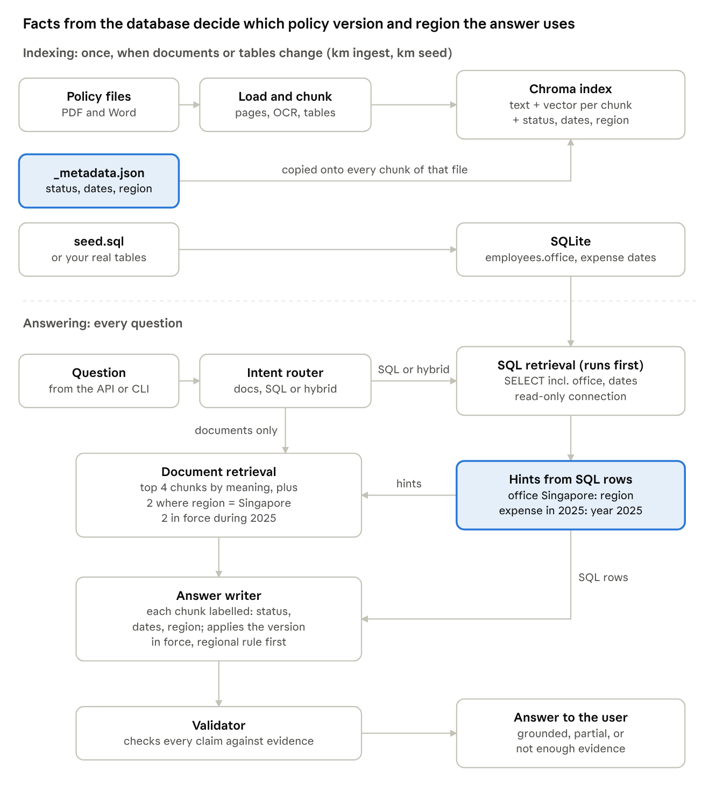
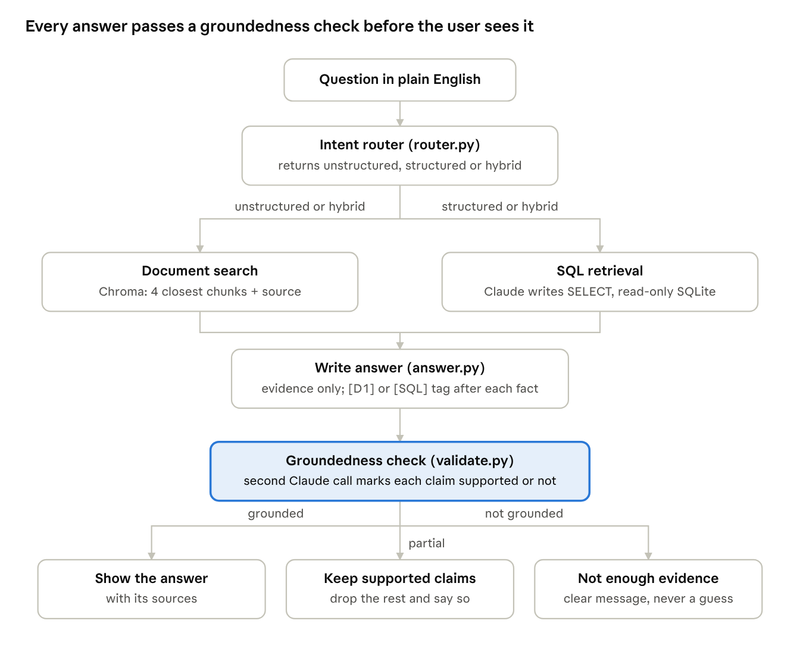
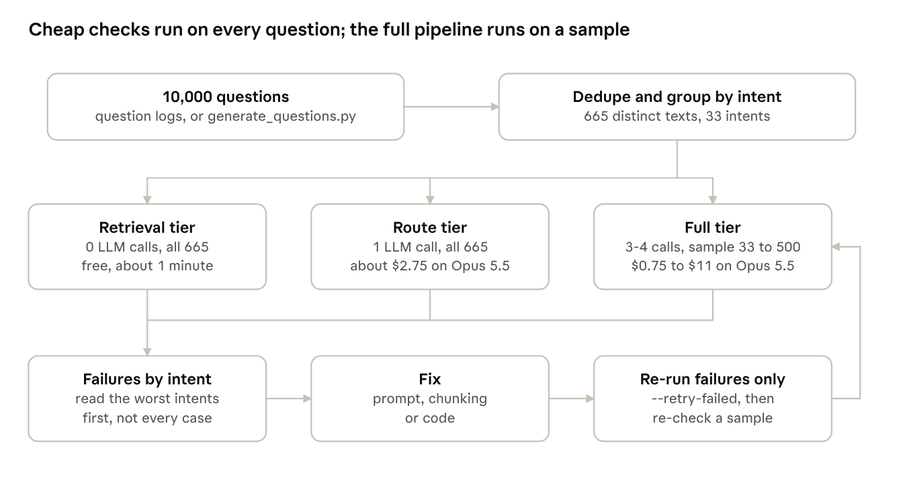

# KM Assistant

A small knowledge-management question-answering backend. It answers plain-English questions from
two kinds of company knowledge, decides by intent where to look, and checks every answer against
the evidence before showing it.

- **Unstructured:** PDF and Word policy documents, chunked and indexed in Chroma.
- **Structured:** SQLite tables (`employees`, `expenses`), queried by model-written, read-only SQL.
- **Routing:** each question goes to documents, SQL, or both (hybrid).
- **Groundedness:** a second LLM call checks the answer claim by claim. Unsupported claims are removed;
  if nothing is supported, the user gets "not enough evidence" instead of a guess.

## Architecture

```
question
  -> IntentRouter            (LLM, structured output: unstructured | structured | hybrid + reason)
  -> SqlRetriever            (structured/hybrid) LLM writes SELECT -> sql_guard -> read-only SQLite
  -> DocRetriever            (unstructured/hybrid) Chroma top-4 chunks + extra chunks from documents
                              for the office (region) and event year that SQL or the question names;
                              each chunk is labelled with file, page, status, validity dates, region
  -> AnswerWriter            (LLM sees only the evidence; must cite [D1]/[SQL] after every fact,
                              or reply INSUFFICIENT_EVIDENCE)
  -> GroundednessValidator   (second LLM call: claim-by-claim verdict; label recomputed in code)
  -> QAService decides       grounded -> answer | partial -> supported claims only | else -> refusal
```





Layered `src/` layout. Dependencies point downward; only `llm/` knows an LLM vendor and only
`storage/` knows Chroma/SQLite.

```
src/km/
  config.py            Settings from .env (the token lives only here at runtime)
  container.py         composition root: builds every object from Settings
  observability.py     Langfuse tracing (on only when keys are set)
  domain/models.py     Route, DocChunk, SqlResult, Evidence, Verdict, AskResult
  llm/                 LLMClient interface, anthropic_client, gateway_client (company AI gateway: chat +
                       embeddings), grok_cli_client (local test double), prompts
  storage/             vector_store (Chroma), sql_store (SQLite, read-only queries)
  ingestion/           loaders (PDF pages + OCR for scans, Word paragraphs + tables), chunker,
                       indexer (attaches docs/_metadata.json: status, effective dates, region)
  routing/ retrieval/ generation/ validation/
  services/qa_service.py   the pipeline and the final decision
  api/app.py           FastAPI: POST /ask, POST /feedback, GET /health; mounts the chat UI at /ui
  api/ui.py            Gradio chat UI (optional `ui` extra): answer, route, evidence, claim check, feedback
  question_log.py      optional log of real questions + feedback (feeds the benchmark)
  bench/               benchmark suite: python -m km.bench run | compare | list | harvest
  cli.py               km seed | ingest | ask | serve
tests/                 unit + integration tests (offline, FakeLLM) and eval/ (real LLM)
data/raw/docs/         4 test documents (fictional company); data/seed/seed.sql matching rows
```

## Key design decisions

| Decision | Why |
| --- | --- |
| SQLite + Chroma | Both run in-process: no database server to install on a company laptop. |
| One `LLMClient` interface | The company gateway (Anthropic SDK) and the local Grok CLI simulator are interchangeable via `KM_LLM_PROVIDER`; tests use a `FakeLLM`. |
| LLM-based routing with a reason | Handles varied phrasing; the reason makes each route explainable and debuggable. |
| Structured outputs for router, SQL writer and validator | No free-text parsing; responses are validated Pydantic objects. |
| Separate validator call, label recomputed in code | The checker is independent of the writer, and the verdict can never contradict its own claim list. |
| Two-layer SQL safety | `sql_guard` allows a single SELECT/WITH only, and the connection is opened `mode=ro`. |
| SQL writer must not encode policy | Thresholds live in the documents; the prompt forbids invented `CASE` flags (found during testing). |
| Word tables are extracted | The expense limits live in a Word table; a paragraphs-only loader silently missed them. |
| Langfuse behind one module | Tracing is optional, and `KM_TRACE_CONTENT=false` keeps prompts and document text out of traces. |
| SQL before documents for hybrid questions | The person's office and the event date decide which policy applies; they steer retrieval (benchmark: fixed all 3 hybrid failures). |
| Document metadata, not model guesswork | `_metadata.json` gives each document a status, validity dates and region; retrieval filters on them and the evidence label shows them. |
| OCR fallback, configurable embeddings | Scanned pages are OCR'd (RapidOCR, Chinese + English); `KM_EMBEDDING_MODEL` switches to a multilingual model for bilingual content. |
| Benchmark-driven changes | Every change is measured with `python -m km.bench` and compared run against run; CI runs tests + the free retrieval stage on every push. |

## How intent routing works

The router prompt describes both sources, including the live SQL schema, and asks for one label:

- **unstructured:** rules, processes, limits and definitions -> document search only.
- **structured:** counts, totals, lists and facts about specific employees or expenses -> SQL only.
- **hybrid:** needs both, typically a database fact compared with a policy rule
  ("Did Dana Kim's travel expense need VP approval?") -> SQL runs first; its facts (office, event
  year) then steer document retrieval toward the regional addendum or the policy version in force.

## How groundedness works

1. The writer sees only tagged evidence (`[D1]`..`[D4]` chunks with file and page, `[SQL]` query and rows)
   and must cite a tag after every fact, or answer `INSUFFICIENT_EVIDENCE`.
2. The validator splits the answer into claims and marks each one supported only if the evidence
   states it explicitly (numbers and names must match; no outside knowledge).
3. Code recomputes the label: all supported -> `grounded`; some -> `partial` (only the supported
   claims are returned, with a note); none -> refusal.

When evidence is insufficient (no chunks and no SQL result, failed or unsafe SQL, the writer says so, or
nothing survives validation), the API returns `status: insufficient_evidence` and the message
"I could not find enough evidence in the documents or database to answer that."

## Run locally

Requires Python 3.11+.

### One-click setup

On Windows, double-click **`setup.cmd`**. On macOS or Linux, run `./setup.sh`. Both run
`scripts/onboard.py`, which does every step below. If Python 3.11+ is missing on Windows, it offers to
install it with winget. It then asks once how to reach an LLM (company token, Grok CLI, or skip), runs
the offline tests and the free retrieval benchmark, asks one live question, and can start the API for you.
You can re-run it at any time. It never overwrites an existing `.env`.

```powershell
setup.cmd --yes --offline     # no prompts, no LLM calls (add --no-bench to skip the benchmark)
```

### Manual setup

```powershell
python -m venv .venv
.venv\Scripts\Activate.ps1
pip install -e ".[dev,ocr,multilingual,ui]"   # ocr/multilingual/ui are optional extras
Copy-Item .env.example .env      # then edit .env (see below)

km seed                          # create SQLite tables + demo rows
km ingest                        # index data/raw/docs (first run downloads an ~80 MB embedding model)
km ask "How many people work in Engineering?"
km serve                         # chat UI at http://127.0.0.1:8000/ui, API at /docs
pytest                           # offline tests, no LLM needed
python tests/eval/run_eval.py    # 17-question evaluation against the configured LLM
```

### Environment variables (.env)

| Variable | Purpose |
| --- | --- |
| `KM_LLM_PROVIDER` | `anthropic` (Anthropic-compatible gateway), `gateway` (company AI gateway, OpenAI-style) or `grok_cli` (local simulator) |
| `KM_GATEWAY_BASE_URL`, `KM_GATEWAY_MODEL` | Company AI gateway, OpenAI-style: base URL `.../v1/<Use Case ID>` (chat = `/chat/completions`, embeddings = `/embeddings`) and the chat model name |
| `KM_GATEWAY_CHAT_URL`, `KM_GATEWAY_EMBED_URL` | Full endpoint URLs instead of a base URL (they win over it) |
| `KM_GATEWAY_TOKEN`, `KM_GATEWAY_AUTH` | Staff AM token (`staff`, sends `Token_Type: SESSION_TOKEN`) or service-account JWT (`service`) |
| `KM_GATEWAY_JSON_MODE` | `prompt` (default), `json_object` or `json_schema` for structured outputs |
| `KM_LLM_API_TOKEN` | Your company LLM token (required for `anthropic`) |
| `KM_LLM_BASE_URL` | Company gateway URL; empty = api.anthropic.com |
| `KM_LLM_AUTH_MODE` | `api_key` (x-api-key header) or `bearer` |
| `KM_LLM_MODEL` | Default `claude-opus-5-5` |
| `KM_GROK_BIN`, `KM_GROK_MODEL`, `KM_GROK_EFFORT` | Grok CLI simulator settings (`KM_GROK_EFFORT=low` is much faster) |
| `HTTPS_PROXY`, `SSL_CERT_FILE` | Only if your network needs them; leave commented out otherwise |
| `LANGFUSE_PUBLIC_KEY`, `LANGFUSE_SECRET_KEY`, `LANGFUSE_BASE_URL` | Optional tracing |
| `KM_TRACE_CONTENT` | `false` = traces carry timings, tokens and scores only |
| `KM_EMBEDDING_MODEL` | `default` (English), a fastembed model, e.g. `intfloat/multilingual-e5-large`, or `gateway:<model>` for the company AI gateway; re-run `km ingest` |
| `KM_OCR_ENABLED` | OCR scanned PDF pages (default `true`; needs the `ocr` extra) |
| `KM_JUDGE_PROVIDER`, `KM_JUDGE_MODEL` | Benchmark grader; use a different model than the one tested |
| `KM_QUESTION_LOG` | Path to log real questions and `/feedback` for `python -m km.bench harvest` (Internal data) |

### Using the company AI gateway

Set `KM_LLM_PROVIDER=gateway` and fill in `KM_GATEWAY_BASE_URL` (the OpenAI SDK's `base_url`, ending in the
use case ID), `KM_GATEWAY_MODEL`, `KM_GATEWAY_TOKEN` and `KM_GATEWAY_AUTH` (or full `KM_GATEWAY_CHAT_URL` /
`KM_GATEWAY_EMBED_URL` instead of the base URL).
The client sends the same request as the gateway's sample script (`testCompanyApi.py`): a Bearer token,
`x-correlation-id` / `x-usersession-id` headers, and TLS verified against the OS certificate store via
`truststore`. Structured outputs (router, SQL writer, validator) put the JSON Schema in the prompt and
validate the reply, with one repair round on invalid JSON; set `KM_GATEWAY_JSON_MODE=json_schema` if the
model supports `response_format`.

For gateway embeddings, set `KM_GATEWAY_EMBED_URL` and `KM_EMBEDDING_MODEL=gateway:<model name>`, then run
`km ingest`. The name only labels the index (each embedding model gets its own Chroma collection) and is
sent as `model` in the request. Chat and embeddings are independent: you can use gateway chat with local
embeddings, or the reverse.

Check connectivity first with `python testCompanyApi.py`: it reads the same `.env` settings and tests chat
(and embeddings, if configured) without running the pipeline.

### Local testing with the Grok CLI

Set `KM_LLM_PROVIDER=grok_cli` to simulate the company gateway with the locally installed, logged-in
`grok` CLI. Each LLM call runs `grok` headless, single-turn, with no tools, in an empty temp folder,
using `--json-schema` for structured outputs. It is slower than a direct API (several seconds per call)
and bills your Grok plan, but needs no company token.

### Chat UI

`km serve` also serves a browser chat UI at http://127.0.0.1:8000/ui (needs the `ui` extra, which installs
Gradio; `/` redirects there). Each answer shows its status and latency; the side panel shows the route and its
reason, the claim-by-claim check, and the evidence behind every `[D1]`/`[SQL]` tag (document chunk with file,
page and metadata, or the SQL query and its rows). Thumbs up/down are logged like `POST /feedback`, and
questions are logged with `channel: "ui"` when `KM_QUESTION_LOG` is set. `/ask` responses now include the same
`evidence` list.

### Example queries

```
km ask "What is the daily meal expense limit?"                        # unstructured
km ask "What is the total amount spent on travel?"                    # structured
km ask "Did Dana Kim's travel expense need VP approval?"              # hybrid
km ask "What is the CEO's salary?"                                    # insufficient evidence
```

## Evaluation results

`python tests/eval/run_eval.py` runs 17 questions from `tests/eval/questions.json` (8 document, 4 SQL,
3 hybrid, 2 not answerable). Run on 2026-11-23 with the Grok CLI simulator (`grok_cli`, effort `low`):

| Metric | Result |
| --- | --- |
| Route accuracy (answerable questions) | 15/15 |
| Expected status (grounded, or refused when unanswerable) | 17/17 |
| Answer contains the expected facts | 15/15 |
| Latency per question | median 20.0 s, max 48.1 s (CLI start-up per call dominates) |

Example hybrid answer (H1):

> Yes. Ben Ortiz has used more annual leave than his 2026 entitlement. On 1 January 2026 his length of
> service, measured from his hire date of 2023-07-15 [SQL], is ... less than 3 years. That gives 20 working
> days of annual leave [D1]. He has 0 carried-over days [SQL], so his allowance for the year is 20 days. He has
> used 22 days [SQL], which is 2 days over that entitlement. Leave beyond the entitlement is unpaid and needs
> HR Director approval as well as the line manager's [D3].

What the first run found, and the fixes:

| Issue | Fix |
| --- | --- |
| SQL writer encoded an invented approval threshold (`CASE WHEN amount_usd > 1000`) | Prompt forbids business rules in SQL |
| Validator rejected "Dana Kim submitted the expense" although her name is in the expense row | Validator prompt: values in one SQL row describe one record |
| Writer refused "Has Ben exceeded his leave?" because carry-over (up to 5 days) was unknown: a real data gap | Added `carried_over_days`; writer and validator get today's date and may do checked arithmetic and date calculations |

Grok is a simulator: re-run the eval against the company gateway (`KM_LLM_PROVIDER=anthropic`) before relying on these numbers.

## Five-question walkthrough (for demos and explaining the pipeline)

Five questions, one per path through the pipeline, each with a printed analysis: route and reason, SQL,
evidence tags, claim-by-claim check, status, and the LLM calls it took.

| # | Question | Route | What it shows | LLM calls |
| --- | --- | --- | --- | --- |
| 1 | What is the daily meal expense limit? | unstructured | documents only, no SQL writer | 3 |
| 2 | What is the total amount spent on travel? | structured | SQL only; SQLite does the arithmetic | 4 |
| 3 | Did Dana Kim's travel expense need VP approval? | hybrid | SQL runs first; its expense date steers document search | 4 |
| 4 | Has Ben Ortiz used more annual leave than the policy allows? | hybrid | an unsupported claim is removed (offline version) | 4 |
| 5 | What is the CEO's salary? | structured | bad SQL retried once, then a refusal, never a guess | 3 |

```powershell
pytest tests/integration/test_five_questions.py -v -s   # offline, scripted model, free and deterministic
python tests/eval/run_five_questions.py                 # the real model, with time per pipeline stage
```

LLM calls set both latency and cost: in a live Grok run of question 1, the 3 calls took 19.0 s of 19.1 s,
and retrieval plus code took 0.16 s. The pipeline saves calls by skipping stages a question does not need.

## Benchmark suite (v2 corpus)

The 17-question eval above runs on a deliberately easy corpus. `benchmarks/corpora/v2` is a harder test world,
generated by `scripts/build_corpus_v2.py` (fixed seed; expected answers computed from the data):

- 9 documents: 2025 (superseded) and 2026 expense policies, a Singapore addendum that overrides group rules,
  a 4-page benefits guide full of similar numbers, a scanned image-only PDF, and an FAQ containing a
  prompt-injection attempt.
- 4 tables: departments, employees (40, three offices), expenses (161, 2025-2026, with approver and status),
  leave_requests (286, incl. pending/rejected rows that must not count). Policy violations are planted.
- 40 cases (`dataset.jsonl`): lookups, long-document, versioned, regional, SQL, hybrid, adversarial and
  must-refuse questions, each with gold sources, gold SQL and/or required/forbidden facts.

```powershell
python scripts/build_corpus_v2.py                                   # (re)generate the corpus
python -m km.bench run --stages retrieval                           # free: no LLM calls
python -m km.bench run --stages route,sql,e2e --workers 2 --label baseline
python -m km.bench run --stages e2e --category hybrid --repeat 3    # flakiness on a slice
python -m km.bench run --stages e2e --judge                         # add LLM grading vs reference answers
python -m km.bench list
python -m km.bench compare <run_a> <run_b>                          # metric deltas + per-case regressions
```

Each run writes `benchmarks/runs/<timestamp>_<corpus>_<provider>[_label]/` with `config.json` (corpus and
dataset hashes, prompts hash, model, effort, top_k, git commit), `results.jsonl` (one record per case and
attempt), `summary.json` and a readable `report.md`. The corpus gets its own SQLite database and Chroma index
under `.bench/<corpus>/`, rebuilt automatically when documents, seed data or chunk settings change.

| Stage | LLM calls/case | Measures |
| --- | --- | --- |
| retrieval | 0 | gold source in top-k (hit@k), hit@1, MRR, all gold sources found |
| route | 1 | routing accuracy |
| sql | 1-2 | execution accuracy: generated SQL returns the gold rows (column-agnostic, top-N aware) |
| e2e | 2-4 | outcome: correct, correct_refusal, false_refusal, hallucination, wrong_or_incomplete, unsafe_content, partial, error |

### Baseline results (2026-11-23, Grok CLI simulator, effort low)

| Stage | Result | Notes |
| --- | --- | --- |
| retrieval | 25/26 found (hit@1 0.73, MRR 0.83) | Miss: H02 never retrieves the Singapore addendum, because "Singapore" is only in the database |
| route | 34/36 -> 36/36 after a dataset fix | H05/H07 went to SQL only; correct, because the question states the threshold (now `acceptable_routes`) |
| sql | 10/10 exact on SQL questions; 4/8 fact coverage on hybrid | Hybrid SQL omits the facts a policy depends on: hire date, office, approver role |
| e2e | 37/40 (CI 80-97%) | 0 hallucinations, 2/2 prompt injections resisted, scanned PDF and 3 out-of-scope questions correctly refused. 3 false refusals: H02, H06 (regional), H04 (versioning) |

Full LLM stages cost about $2.20 on Grok and took about 13 minutes with 2 workers. Runs:
`benchmarks/runs/20261123-215850_v2_grok_cli_baseline` (retrieval), `20261123-215903_v2_grok_cli_baseline`
(route, sql, e2e), `20261123-221337_v2_grok_cli_scoring-v2` (hybrid re-score after the dataset and scoring fixes).

**Main weakness found:** hybrid questions where the applicable policy depends on a database fact (office ->
regional addendum; expense date -> policy version). Retrieval and SQL run in parallel and independently, so
neither knows what the other found. Next step: run SQL first, then retrieve with those facts (and filter
chunks by region and effective date), and tell the SQL writer which attributes policies depend on.

### After implementing the six suggestions (same day, same LLM and effort)

| v2 stage | Baseline | Now | Change |
| --- | --- | --- | --- |
| retrieval (free) | 25/26 | 27/27 | H02 now finds the Singapore addendum; the scanned minutes are OCR'd |
| route | 34/36 | 37/37 | dataset labels fixed (`acceptable_routes`) |
| sql | 13/18 | 16/18 | SQL writer now returns office, dates and approver role for policy checks |
| e2e | 37/40 | 39/40 (CI 87-100%) | H02, H04, H06 fixed; K01 answered via OCR; A02 now refuses (safe, unhelpful) |
| e2e hybrid x3 repeats | - | 24/24 | no flaky hybrid cases |

The 2 remaining SQL "mismatches" (H01, H02) return one row per leave request instead of the total; the writer
sums them correctly, so this is a limit of the fact-coverage scoring, not a system error.

What was implemented:

1. **Sequential hybrid flow** (`QAService._retrieve`, `retrieval/doc_retriever.py`): SQL first; `hints_from()`
   extracts offices and event years (and years named in the question); retrieval adds the best chunks from
   documents for that region or in force that year. The SQL prompt asks for policy-relevant attributes.
2. **Document metadata** (`docs/_metadata.json`, read by the indexer): status, effective dates, region,
   language on every chunk; used as Chroma filters and shown in each evidence label. Prompts tell the
   writer to apply the version in force and regional rules, and to treat document text as data.
3. **Growing the dataset from real use**: `KM_QUESTION_LOG` logs `/ask` and `/feedback`;
   `python -m km.bench harvest` writes failures and unhelpful answers as `needs_review` drafts to
   `<corpus>/candidates.jsonl` (deduplicated against the dataset).
4. **CI** (`.github/workflows/ci.yml`): every push runs pytest and the free retrieval benchmark with
   `--fail-under retrieval=0.9`; a manual run with `full=true` runs the LLM stages against the gateway
   (use a self-hosted runner inside the company network).
5. **Independent judge**: `--judge` grades answers with `KM_JUDGE_PROVIDER`/`KM_JUDGE_MODEL`.
6. **OCR and multilingual embeddings**: RapidOCR for scanned pages; `KM_EMBEDDING_MODEL` picks a fastembed model
   (each model gets its own Chroma collection). The 3 public Hang Seng Bank PDFs are now a separate corpus,
   `benchmarks/corpora/real` (16 questions incl. 3 in Chinese).

Embedding comparison (retrieval stage, free):

| Model | v2 (synthetic, English) | real (Hang Seng, bilingual) | Size |
| --- | --- | --- | --- |
| default (all-MiniLM-L6-v2) | 27/27, hit@1 0.74 | 13/14: misses the Chinese question CN01 | 80 MB |
| paraphrase-multilingual-MiniLM-L12-v2 | 26/27, hit@1 0.63 | 14/14, hit@1 0.93 | 241 MB |
| multilingual-e5-large | 27/27, hit@1 0.78 | 14/14, hit@1 0.86 | 2.1 GB |

Real corpus end to end (e5-large, judged by grok-4.6): 14/16; judge 4/4. Misses: HS07, where fixed 800-character
chunks cut a bulleted list (the answer even mentions a "truncated line"), and CN02 (partial). Next
improvement: split chunks at headings and list boundaries. Runs: `..._v2_grok_cli_suggestions`,
`..._v2_grok_cli_hybrid-repeat3`, `..._real_grok_cli_e5-judge`, plus the `emb-*` retrieval runs.
All LLM runs in this round cost about $4.10 on Grok.

## Scaling the eval to 10,000 questions

Real question logs repeat a lot. `scripts/generate_questions.py` simulates 10,000 logged questions
(33 intents x 2-3 wordings x 10 phrasing wrappers, drawn with skewed popularity). Ground truth for SQL
questions is computed by running SQL, not typed by hand.



```powershell
python scripts/generate_questions.py --n 10000                     # tests/eval/questions_10k.jsonl
python tests/eval/run_scale_eval.py plan                           # counts, no LLM calls
python tests/eval/run_scale_eval.py retrieval --workers 4          # all distinct questions, 0 LLM calls
python tests/eval/run_scale_eval.py route --sample per-intent --workers 4
python tests/eval/run_scale_eval.py full  --sample per-intent --workers 4
python tests/eval/run_scale_eval.py full  --sample per-intent --retry-failed   # after a fix: re-run only failures
```

Flow: generate or collect questions -> dedupe (10,000 rows = 665 distinct texts = 33 intents) -> run tiers
cheapest first -> read failures grouped by intent -> fix -> re-run only the failures -> re-run a sample to
check for regressions. Results are written to `tests/eval/runs/` as JSONL, so runs are resumable.

### Demo results (2026-11-23, Grok CLI simulator, 4 workers)

| Tier | Questions | LLM calls / question | Result | Wall time | Measured Grok cost |
| --- | --- | --- | --- | --- | --- |
| retrieval (expected doc in top 4) | 506 distinct (doc + hybrid) | 0 | 100% top-4, 93.3% top-1 (CI 90.8-95.2%) | 54 s | $0 |
| route | 30 (one per answerable intent) | 1.0 | 30/30 | 51 s | $0.36 |
| full pipeline | 33 (one per intent) | 3.2 | 30/33 = 90.9% (CI 76.4-96.9%) | 192 s | $1.23 |

What it found: top-1 retrieval misses concentrate in three Word-document intents (claim deadline, meal
limit, learning budget); the SQL writer once invented a column (`expenses.amount`), now handled by one
self-correction retry with the database error; two answers were safely "partial" (right fact, one
over-reaching claim removed); one hybrid failure did not reproduce on re-run (model randomness).

### Cost of 10,000 questions (full pipeline)

Measured per question: 3.2 LLM calls, ~1,600 input tokens, ~800 output tokens including reasoning
(input = prompt characters / 4; output = Grok's reported tokens, used as a proxy for Claude's thinking).
Claude figures are list-price estimates; check your company gateway's pricing.

| Scenario | Questions | LLM calls | Grok CLI (measured rate) | Claude Opus 5.5 | Opus 5.5 batch (50% off) | Claude Sonnet 5.5 | Claude Haiku 5.5 |
| --- | --- | --- | --- | --- | --- | --- | --- |
| Every row | 10,000 | ~31,500 | $373 | $226 | $113 | $113 | $5.65 |
| Distinct texts only | 665 | ~2,100 | $24.80 | $15.03 | $7.51 | $7.52 | $0.38 |
| Stratified sample | 500 | ~1,600 | $18.65 | $11.30 | $5.65 | $5.65 | $0.28 |
| One per intent | 33 | ~104 | $1.23 | $0.75 | $0.38 | $0.37 | $0.02 |

Recommended cadence: unit tests + retrieval tier on every change (free); route tier on all distinct
questions plus full tier on one per intent for every prompt or model change (about $3.50 on Opus 5.5);
full tier on a stratified 500 before a release (about $11 on Opus 5.5). Running all 10,000 rows mostly
re-asks the same 665 questions.
